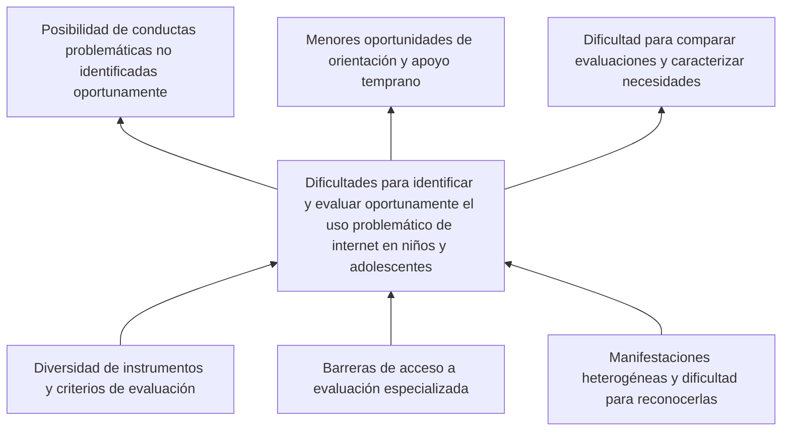

# Prediccion-Uso-Problematico-Internet MIAA 2026-2

**Universidad Icesi — Maestría en Inteligencia Artificial Aplicada**  
**Asignatura:** Proyecto de Innovación IA · **Periodo académico:** 2026-2  
**Autor:** Christian Cuello · [GitHub: ChrisCuello](https://github.com/ChrisCuello)  
**Estado:** Primera entrega documentada; segunda entrega (EDA y modelos de referencia) ejecutada; evaluación final en desarrollo

## Presentación

Internet forma parte de la vida cotidiana de niños y adolescentes y ofrece oportunidades de aprendizaje, comunicación y entretenimiento. Sin embargo, su utilización puede considerarse problemática cuando existen dificultades para regularla y se presentan interferencias en las actividades habituales, las relaciones personales o el bienestar. Esta condición no se define únicamente por la cantidad de horas de conexión: involucra comportamientos, contextos y repercusiones que no siempre son fáciles de evaluar [1–3].

El interés por comprender este fenómeno ha motivado estudios sobre sus manifestaciones y factores asociados, así como la búsqueda de métodos que complementen las evaluaciones tradicionales. Entre estas iniciativas se encuentra la competición *Child Mind Institute — Problematic Internet Use*, organizada con Kaggle a partir de datos del estudio **Healthy Brain Network (HBN)**. El reto invita a investigar si indicadores físicos y de actividad, junto con otras características de los participantes, permiten estimar niveles de severidad del uso problemático de internet [4, 5].

En este contexto, el proyecto **Prediccion-Uso-Problematico-Internet MIAA 2026-2** plantea una investigación académica basada en aprendizaje automático. Su propósito no es establecer diagnósticos ni reemplazar la valoración profesional, sino examinar el potencial y las limitaciones de una aproximación predictiva construida con datos existentes.

## Contexto y delimitación del problema

La evaluación del uso problemático de internet en población infantil y adolescente enfrenta dificultades conceptuales y prácticas. Los estudios utilizan instrumentos y criterios que no son completamente uniformes, mientras que las manifestaciones del fenómeno pueden variar según la edad, las circunstancias personales y las actividades realizadas en línea [1, 3]. A esto pueden sumarse barreras para acceder a valoraciones especializadas y la dificultad de reconocer oportunamente cuándo determinados comportamientos requieren atención [5].

La relevancia de esta situación se relaciona con los hallazgos de investigaciones que describen asociaciones entre el uso problemático de internet y el funcionamiento cotidiano, la calidad de vida y algunos aspectos de la salud mental [2, 6, 7]. No obstante, estas asociaciones deben interpretarse con prudencia: no permiten afirmar por sí solas que un mayor uso de internet cause ansiedad, alteraciones del sueño o dificultades académicas. Las relaciones pueden ser bidireccionales o depender de otros factores.

De este análisis se desprende el problema social que motiva la investigación: **las dificultades para identificar y evaluar oportunamente el uso problemático de internet en niños y adolescentes, en un escenario de manifestaciones heterogéneas, diversidad de instrumentos y posibles barreras de acceso a evaluación especializada**.

### Relaciones entre causas y efectos

El árbol de problemas sintetiza las barreras que podrían contribuir a esta dificultad y algunas de sus consecuencias potenciales. Su organización parte del problema social, sin confundirlo con las tareas técnicas necesarias para construir un modelo predictivo.

*Figura 1. Árbol de problemas propuesto a partir de la revisión inicial de literatura. Las conexiones expresan relaciones conceptuales plausibles que requieren sustento documental; no representan efectos causales demostrados experimentalmente.*

Las dificultades en la definición y medición pueden obstaculizar una evaluación consistente [1, 3]. Asimismo, las barreras de acceso y la variedad de manifestaciones podrían restringir las oportunidades de identificación y orientación temprana [5]. Por otra parte, factores como la soledad, el malestar psicológico, el sueño y la actividad física se estudiarán como posibles **variables asociadas**, sin clasificarlas de antemano como causas o consecuencias directas [2, 6, 7].

### Pregunta y propósito de la investigación

El desafío planteado por el Child Mind Institute ofrece la posibilidad de explorar una respuesta tecnológica parcial a este problema social. Aunque las mediciones físicas, demográficas y de actividad están disponibles en el HBN, aún es necesario establecer cuánto aportan a una predicción confiable cuando se excluyen variables que revelan directamente la etiqueta de severidad. El conjunto de datos, además, presenta valores faltantes y diferencias en la disponibilidad de mediciones entre participantes [4].

La investigación se orienta mediante la siguiente pregunta:

> **¿En qué medida los modelos de aprendizaje automático permiten predecir los niveles de severidad del uso problemático de internet en niños y adolescentes a partir de variables físicas, demográficas y de actividad, utilizando los datos del Healthy Brain Network?**

Para responderla, se propone **desarrollar y comparar, a más tardar el 1 de diciembre de 2026, al menos tres configuraciones de aprendizaje automático para predecir los cuatro niveles de severidad del uso problemático de internet**, utilizando los datos del HBN y evaluando su desempeño mediante QWK, F1-macro y matrices de confusión, así como sus limitaciones metodológicas.

Este propósito se desarrollará mediante tres objetivos específicos:

1. **Caracterizar, hasta el 14 de noviembre de 2026, la totalidad de las variables del conjunto tabular de entrenamiento del HBN**, documentando el porcentaje de valores faltantes por variable, la disponibilidad de la etiqueta `sii`, la distribución de las cuatro categorías y los criterios preliminares de selección y exclusión de predictores.
2. **Preparar los datos e implementar, hasta el 14 de noviembre de 2026, al menos dos modelos de referencia**, documentando la partición de entrenamiento y validación, las decisiones de preprocesamiento y el control de fuga de información, incluida la exclusión de `PCIAT-PCIAT_Total` como predictor de `sii`.
3. **Comparar, hasta el 1 de diciembre de 2026, al menos tres configuraciones predictivas**, utilizando QWK como métrica principal, F1-macro y matrices de confusión como medidas complementarias, y presentar un análisis de errores por categoría y de las limitaciones para generalizar los resultados.

La investigación tiene interés social por el fenómeno abordado y valor metodológico por la oportunidad de estudiar datos heterogéneos, sesgos de representación y técnicas de predicción en un contexto sensible. Sus productos tendrán carácter exploratorio y académico.

## Antecedentes científicos y tecnológicos

### Comprensión y medición del uso problemático de internet

La ausencia de una definición operacional plenamente uniforme constituye una dificultad relevante para estudiar el fenómeno. Schlossarek y colaboradores (2024) revisaron instrumentos de cribado destinados a niños y adolescentes y analizaron sus propiedades psicométricas [1]. Por su parte, Pérez-Wiesner y colaboradores (2024) abordaron la validación de un instrumento para identificar uso problemático de internet en adolescentes [3]. Estos antecedentes muestran por qué la elección de una escala, sus criterios y su población de aplicación deben examinarse antes de interpretar sus resultados.

La información anterior es particularmente importante para el presente proyecto: el desenlace que se intentará predecir es una categoría derivada de una medición específica, no un diagnóstico clínico universal.

### Asociaciones con bienestar y funcionamiento cotidiano

Restrepo y colaboradores (2020) investigaron asociaciones entre uso problemático de internet, trastornos psiquiátricos y deterioro funcional en niños y adolescentes [2]. Tóth-Király y colaboradores (2021) estudiaron trayectorias longitudinales y antecedentes individuales y sociales, así como resultados asociados [6]. Machimbarrena y colaboradores (2019) analizaron perfiles de uso problemático y calidad de vida relacionada con la salud [7].

En conjunto, estos trabajos proporcionan fundamento para la relevancia social de la investigación y, a la vez, invitan a distinguir entre asociación estadística, capacidad de predicción y causalidad. Una variable que ayude a estimar un nivel de severidad no necesariamente explica su origen ni constituye por sí misma un criterio para intervenir.

### Desarrollo de soluciones predictivas

El reto del Child Mind Institute y Kaggle plantea una tarea de predicción sobre cuatro categorías ordenadas de severidad, utilizando datos del HBN. Entre los recursos disponibles se encuentran variables demográficas y físicas, cuestionarios y series de actigrafía. La competición propone evaluar la concordancia entre valores reales y predichos mediante el **coeficiente kappa ponderado cuadráticamente (QWK)** [4].

La revisión bibliográfica preliminar también permitió identificar trabajos que estudian enfoques de aprendizaje automático para este problema o problemas estrechamente relacionados:

| Investigación | Enfoque descrito | Consideración para este proyecto |
|---|---|---|
| Karthiga M. y colaboradores (2024) [8] | Ensamble de LightGBM, XGBoost, CatBoost y TabNet; el resumen del artículo original reporta **QWK = 0,92**. | El resultado está documentado por la revista; se requiere examinar las variables utilizadas y el protocolo de validación antes de compararlo con los experimentos propios. |
| Suh y Yoo (2025) [9] | Predicción del nivel de riesgo desde una perspectiva de salud digital. | Revisar los métodos de preparación de datos y los factores considerados. |
| Malallah e Iqbal (2026) [10] | Estudio con datos del HBN; el resumen editorial original reporta **exactitud del 100 %** para Gradient Boost Regression. | Comprobar el alcance de la métrica y el procedimiento de validación descrito; examinar posibles riesgos de sobreajuste y fuga de información antes de interpretarla como generalizable. |
| Niteesh K. R. y Pooja T. S. (2025) [11] | Comparación de ensambles con optimización bayesiana; el artículo original reporta para XGBoost **QWK medio = 0,7218** en validación cruzada estratificada de cinco particiones. | La métrica procede de la tabla de resultados publicada; su comparación requiere considerar la partición y los predictores empleados. |

Estos antecedentes sugieren alternativas de modelado que vale la pena explorar. Los valores de QWK de [8] y [11], y la exactitud declarada por [10], fueron contrastados con las publicaciones originales; **esta comprobación bibliográfica no equivale a validar de manera independiente sus experimentos**. En particular, los valores extremos deben analizarse a la luz de las variables, las particiones y la posibilidad de fuga de información. Tampoco resulta válido comparar directamente exactitud, AUC y QWK, porque miden aspectos distintos y pueden provenir de diseños experimentales diferentes. Para [9] queda pendiente examinar en detalle el texto completo.

Las soluciones ganadoras de la competición aportan antecedentes prácticos adicionales. **Lennart Haupts (primer lugar)** documentó un ensamble de modelos de árboles —LightGBM, XGBoost, CatBoost y ExtraTrees—, ingeniería de características, imputación y validación cruzada estratificada. En lugar de entrenar directamente con las clases `sii`, utilizó `PCIAT-PCIAT_Total` como variable objetivo continua y transformó posteriormente las predicciones a las categorías requeridas [12]. **Aradhye Agarwal (segundo lugar)** destacó el tratamiento diferenciado de los valores faltantes según el significado de cada variable y la ampliación de la validación cruzada, partiendo de un notebook de referencia [13]. Ambos documentos son **reportes técnicos de participantes de Kaggle**, no publicaciones clínicas revisadas por pares, por lo que se utilizarán como antecedentes metodológicos y no como evidencia de validez clínica.

El aporte esperado del proyecto consistirá en evaluar modelos bajo condiciones de preparación y validación comparables, examinando de manera explícita los valores faltantes, la distribución de las categorías, las variables utilizadas y la posibilidad de generalizar los resultados.

Una precaución central es evitar la **fuga de información**. En los datos de la competición, `sii` se deriva de `PCIAT-PCIAT_Total` [4]. Conviene distinguir dos usos: **predecir `PCIAT-PCIAT_Total` como variable objetivo continua y convertir luego el resultado a `sii`**, tal como documentó el primer lugar [12], puede constituir una estrategia de entrenamiento; en cambio, **introducir `PCIAT-PCIAT_Total` como predictor para estimar `sii`** permitiría reconstruir la etiqueta y produciría fuga directa de información. La selección de variables, imputación y ajuste de modelos deberán ejecutarse sin utilizar información del conjunto reservado para evaluación.

## Enfoque metodológico y desarrollo por etapas

El trabajo seguirá una adaptación de **CRISP-DM**, iniciando con la comprensión del problema y de los datos, para continuar con su preparación, el desarrollo de modelos, la evaluación y la comunicación de resultados. Esta secuencia permite vincular las decisiones técnicas con la pregunta de investigación y documentar el proceso de manera reproducible.

Se utilizarán los datos publicados para la competición *Child Mind Institute — Problematic Internet Use*, procedentes del Healthy Brain Network [4]. La información incluye archivos tabulares en formato CSV y series de actigrafía en formato Parquet. La variable objetivo, `sii` (*Severity Impairment Index*), presenta cuatro niveles ordenados: **0 (ninguno), 1 (leve), 2 (moderado) y 3 (severo)**. El análisis exploratorio inicial, la selección razonada de variables y la comparación de dos modelos de referencia ya se documentaron en la segunda etapa; las evaluaciones adicionales quedan para fases posteriores.

La implementación se desarrolla principalmente con **Python en Google Colab**, apoyándose en Pandas y Scikit-learn. Kaggle y, cuando resulte apropiado, KaggleHub facilitarán el acceso a los recursos. GitHub se utilizará para documentar avances, scripts, notebooks y decisiones; las bases de datos voluminosas no se incorporarán directamente al repositorio.

### Plan de trabajo

El siguiente calendario registra la planificación original del proyecto durante el último trimestre de 2026. Algunas tareas de exploración y experimentación se completaron anticipadamente; para el estado efectivo debe consultarse la sección «Segunda entrega».

| Periodo | Trabajo previsto | Producto esperado |
|---|---|---|
| **Hasta el 10 de octubre** | Delimitación del problema, revisión bibliográfica inicial, árbol de problemas, formulación de objetivos y organización del proyecto. | Documento inicial publicado en GitHub. |
| **11–24 de octubre** | Acceso a los recursos de HBN, comprensión del diccionario de datos, identificación de variables y evaluación inicial de su disponibilidad. | Inventario de variables y primeras observaciones exploratorias. |
| **25 de octubre–7 de noviembre** | Análisis de valores faltantes, desbalance, relaciones entre variables y posibles fuentes de fuga de información. | Análisis exploratorio documentado y justificación inicial de variables. |
| **8–14 de noviembre** | Preparación de particiones de datos, definición de hipótesis y entrenamiento de **al menos dos modelos de referencia**, con control documentado de fuga de información. | Reporte de exploración y primeros experimentos, con entrega el **14 de noviembre**. |
| **15–23 de noviembre** | Comparación y ajuste de modelos hasta completar **al menos tres configuraciones**, evaluación con QWK y F1-macro y análisis de matrices de confusión. | Resultados comparativos y discusión preliminar. |
| **24 de noviembre–1 de diciembre** | Integración de resultados, discusión de limitaciones, conclusiones, revisión de referencias y preparación del video académico. | Informe final y sustentación en video, con entrega el **1 de diciembre**. |

El volumen de los archivos de actigrafía y los recursos computacionales disponibles en Colab hacen aconsejable iniciar con un modelo de referencia basado en información tabular. La incorporación de las series temporales dependerá de su viabilidad, del tiempo disponible y del valor analítico que puedan aportar. La preparación y cualquier técnica de balanceo deberán realizarse sin utilizar información del conjunto de evaluación para ajustar el modelo.

## Segunda entrega: análisis exploratorio y modelos de referencia

**Corte de resultados: 23 de octubre de 2026.** Esta sección documenta actividades realizadas y resultados propios de la segunda etapa. Complementa la formulación de la primera entrega y no constituye una validación clínica ni una predicción prospectiva.

### Población y análisis exploratorio de datos

Se examinó el archivo tabular de entrenamiento de la competición HBN/Kaggle, integrado por **3.960 registros y 82 columnas**. La etiqueta ordinal `sii` estaba disponible en **2.736 participantes**. Para el análisis principal se delimitó, antes del entrenamiento, una cohorte de **2.652 participantes de 5 a 17 años**: clase 0, **1.562**; clase 1, **700**; clase 2, **360**; y clase 3, **30**. Como análisis de sensibilidad se conservaron las cohortes de 5–19 y 5–22 años.

El EDA comprendió integridad estructural, disponibilidad de etiquetas, distribución por severidad, datos faltantes, plausibilidad de mediciones físicas, relaciones y redundancias entre variables. El desbalance de la categoría severa (**1,13 % de la cohorte principal**) obliga a examinar métricas por clase, además de las métricas globales.

La auditoría instrumental de **996 series Parquet** identificó heterogeneidad en continuidad cronológica y uso del dispositivo. En **966 series** existía algún registro posterior a la administración de PCIAT. Por este motivo, y por la cobertura parcial de actigrafía, estas señales **no se utilizaron en los modelos de referencia**. La existencia de registros posteriores no equivale por sí sola a fuga matemática directa, pero impide asumir disponibilidad anticipada para una aplicación prospectiva.

### Selección razonada de características

La matriz de selección evaluó los **58 campos tabulares distintos del identificador, la etiqueta y las 22 columnas PCIAT**. Las primeras comparaciones se definieron antes de entrenar modelos:

| Bloque | Variables incluidas | Justificación |
|---|---|---|
| **A. Demográfico** | Edad y sexo | Línea base contextual, con cobertura completa en la cohorte principal. |
| **B. Físico** | A + IMC, frecuencia cardíaca, presión sistólica y presión diastólica | Determinar si las mediciones físicas aportan información adicional a la demografía. |
| **C. Ampliado** | B + puntuación T de sueño SDS y categoría declarada de horas de internet | Explorar el aporte incremental de dos indicadores conductuales, sin atribuir causalidad. |

Los ocho campos se seleccionaron por pertinencia, disponibilidad y comparabilidad de los bloques, **no por optimización posterior al resultado**. Los campos PCIAT se excluyeron como predictores porque `sii` se deriva de su puntuación total; `id` se utilizó exclusivamente como identificador. CGAS, PAQ-A/PAQ-C, FitnessGram, bioimpedancia, variables de temporada y actigrafía quedaron reservados para análisis posteriores por cobertura, solapamiento conceptual, redundancias o temporalidad no confirmada. Aplazamiento no significa descarte definitivo [14–16].

### Hipótesis y protocolo experimental

Se compararon tres contrastes:

- **H1:** agregar medidas físicas al bloque demográfico mejora el QWK (**B − A**).
- **H2:** agregar conjuntamente SDS-T e internet declarado al bloque físico mejora el QWK (**C − B**).
- **H3 (exploratoria):** cada indicador, por separado, aporta información al bloque físico (**B + SDS − B** y **B + internet − B**).

**Precisión metodológica:** los bloques A/B/C y el protocolo de comparación se definieron antes de entrenar. Sin embargo, la redacción direccional de H1/H2 se formalizó después de observar los primeros resultados y H3 se planteó en una ablación posterior. Por consiguiente, los contrastes son **descriptivos y exploratorios, no pruebas confirmatorias preinscritas**.

Se implementaron dos clasificadores de referencia: **regresión logística multiclase regularizada** e **HistGradientBoostingClassifier**. Se utilizó **validación cruzada estratificada de cinco particiones, repetida tres veces** (15 evaluaciones internas), con particiones emparejadas para las comparaciones. La imputación, indicadores de ausencia, escalamiento y codificación se ajustaron exclusivamente en la porción de entrenamiento de cada pliegue; ambos algoritmos utilizaron `class_weight="balanced"`. No se optimizaron hiperparámetros en estas corridas.

### Resultados iniciales

| Configuración | Logística QWK | Logística F1-macro | Boosting QWK | Boosting F1-macro |
|---|---:|---:|---:|---:|
| A. Demográfica | 0,325 | 0,316 | 0,284 | 0,284 |
| B. Física | 0,323 | 0,321 | 0,291 | 0,331 |
| B + sueño SDS-T | 0,368 | 0,339 | 0,362 | 0,357 |
| B + internet declarado | 0,361 | 0,342 | 0,338 | 0,346 |
| C. Ampliada | **0,405** | 0,356 | **0,388** | **0,365** |

En QWK, **B no mejoró consistentemente A** (H1 no apoyada de forma consistente). El bloque C superó B en los 15 pliegues de ambos clasificadores: diferencias medias **+0,082** en logística y **+0,097** en boosting. Los indicadores SDS-T e internet declarado también mostraron aportes individuales positivos en comparaciones exploratorias. Debido a que las evaluaciones repetidas comparten participantes, **no se tratan como 15 muestras independientes** ni se interpretan como evidencia confirmatoria.

En la categoría severa (`sii=3`), con solo **30 participantes**, la precisión de C fue de aproximadamente **6,0 %** para logística y **5,4 %** para boosting; sus sensibilidades respectivas fueron **62,2 %** y **8,9 %**. Esto evidencia numerosas falsas alarmas. El desempeño agregado no sustenta identificar casos severos de manera fiable ni implementar la solución como herramienta clínica.

### Reproducibilidad, límites y trabajo siguiente

Los cálculos están respaldados por el cuaderno **Notebook_04_Modelos_referencia_PIU_MIAA_Colab.ipynb** y los paquetes de resultados **Resultados_Modelos_Referencia_PIU_MIAA_2026-2_v1.zip** y **Resultados_Analisis_Metodologico_Segunda_Etapa_MIAA_v1.zip**, conservados en el entorno de trabajo del proyecto. La matriz de variables y los notebooks de EDA y auditoría documentan las decisiones previas. **La mención de estos archivos no implica que estén publicados en este repositorio.** No deben incorporarse datos individuales ni grandes archivos Parquet sin revisar privacidad y condiciones de uso.

Los resultados representan una **estimación concurrente exploratoria** mediante validación interna; no demuestran causalidad, rendimiento prospectivo, validez externa ni utilidad clínica. La siguiente fase podrá examinar estrategias ordinales, sensibilidad a la ponderación de clases, mecanismos de datos faltantes y evaluación independiente si resulta viable [15, 16].

## Alcance, consideraciones éticas y limitaciones

El proyecto empleará datos disponibles para investigación que se distribuyen sin identificación directa de los participantes, respetando las condiciones de uso de la fuente. Al trabajar con información vinculada con menores de edad y salud mental, se evitará publicar datos identificables, se reconocerán los posibles sesgos del conjunto y se presentarán las predicciones con prudencia.

El desempeño de un modelo en esta base no demuestra que pueda detectar casos clínicos en escenarios reales. Tampoco permite concluir que las características físicas o de actividad sean causas del uso problemático de internet. Una aplicación externa exigiría validación independiente, evaluación de seguridad y consideración del contexto de uso y de las poblaciones a las que estaría dirigida.

## Conclusiones de la primera etapa

La revisión inicial permitió delimitar un problema social relacionado con las dificultades para identificar y evaluar oportunamente el uso problemático de internet en niños y adolescentes. La diversidad de instrumentos y manifestaciones, junto con las asociaciones descritas con aspectos del bienestar y del funcionamiento cotidiano, justifican estudiar enfoques complementarios sin asumir relaciones causales no demostradas.

Los antecedentes científicos y las experiencias de la competición muestran el potencial de explorar modelos predictivos con información del Healthy Brain Network. Sin embargo, la calidad de los datos, la selección de variables, la estrategia de validación y el control de fuga de información condicionarán la interpretación de los resultados. La segunda etapa avanzó en esta evaluación mediante EDA y modelos de referencia; sus resultados y limitaciones se consignan en el apartado anterior.

## Referencias

Las referencias se presentan con autores explícitos y numeración consecutiva; se conserva la correspondencia de los números históricos del README con sus citas en el texto.

[1] S. Schlossarek, L. Hohls, H. Schmidt, A. Bischof, G. Bischof, D. Brandt, S. Borgwardt, D. T. Browne, D. Christakis, P. Hurst-Della Pietra, Z. Demetrovics y H.-J. Rumpf, “Which Are the Optimal Screening Tools for Internet Use Disorder in Children and Adolescents? A Systematic Review of Psychometric Evidence,” *Current Addiction Reports*, vol. 11, pp. 753–770, 2024. doi: [10.1007/s40429-024-00568-w](https://doi.org/10.1007/s40429-024-00568-w).

[2] A. Restrepo, T. Scheininger, J. Clucas, L. Alexander, G. A. Salum, K. Georgiades, D. Paksarian, K. R. Merikangas y M. P. Milham, “Problematic internet use in children and adolescents: associations with psychiatric disorders and impairment,” *BMC Psychiatry*, vol. 20, art. 252, 2020. doi: [10.1186/s12888-020-02640-x](https://doi.org/10.1186/s12888-020-02640-x).

[3] M. Pérez-Wiesner, K.-M. Bühler y J. A. López-Moreno, “Validation of an Instrument for Detecting Problematic Internet Use in Adolescents,” *Behavioral Sciences*, vol. 14, n.º 8, art. 715, 2024. doi: [10.3390/bs14080715](https://doi.org/10.3390/bs14080715).

[4] Child Mind Institute y Kaggle, “Child Mind Institute — Problematic Internet Use,” *Kaggle*, competición y conjunto de datos, 2024. Disponible: https://www.kaggle.com/competitions/child-mind-institute-problematic-internet-use

[5] Child Mind Institute, “Child Mind Institute and Kaggle Launch Competition to Predict Teen Internet Addiction,” 2024. Disponible: https://childmind.org/blog/child-mind-institute-and-kaggle-launch-competition-to-predict-teen-internet-addiction/

[6] I. Tóth-Király, A. J. S. Morin, L. Hietajärvi y K. Salmela-Aro, “Longitudinal Trajectories, Social and Individual Antecedents, and Outcomes of Problematic Internet Use Among Late Adolescents,” *Child Development*, vol. 92, n.º 4, pp. e653–e673, 2021. doi: [10.1111/cdev.13525](https://doi.org/10.1111/cdev.13525).

[7] J. M. Machimbarrena, J. González-Cabrera, J. Ortega-Barón, M. Beranuy-Fargues, A. Álvarez-Bardón y B. Tejero, “Profiles of Problematic Internet Use and Its Impact on Adolescents’ Health-Related Quality of Life,” *International Journal of Environmental Research and Public Health*, vol. 16, n.º 20, art. 3877, 2019. doi: [10.3390/ijerph16203877](https://doi.org/10.3390/ijerph16203877).

[8] Karthiga M., S. Ramar, Archudha A., Kavya D. N., D. Buchade y A. K. Tripathy, “MREM-IUP - A MultiRegressor Based Ensemble Model for Assessing the Internet Addiction in Youth Using Physical and Behavioural Indicators,” *South Eastern European Journal of Public Health*, vol. XXV, pp. 1182–1189, 2024. doi: [10.70135/seejph.vi.2370](https://doi.org/10.70135/seejph.vi.2370).

[9] Y. Suh y J. Yoo, “Risk level prediction for problematic internet use: A digital health perspective,” *Internet Interventions*, 2025. doi: [10.1016/j.invent.2025.100863](https://doi.org/10.1016/j.invent.2025.100863).

[10] F. L. Malallah y K. Iqbal, “Predicting Signs of Problematic Internet Use to Analyze Children’s Health Using Machine Learning,” en *Proceedings of the 19th International Joint Conference on Biomedical Engineering Systems and Technologies*, vol. 1: BIOSIGNALS, pp. 247–254, SciTePress, 2026. doi: [10.5220/0014231300004070](https://doi.org/10.5220/0014231300004070).

[11] Niteesh K. R. y Pooja T. S., “Predicting Problematic Internet Use in Children Using Feature-Rich Structured Data with Ensemble Machine Learning and Bayesian Optimisation,” en *2025 Asia Pacific Signal and Information Processing Association Annual Summit and Conference (APSIPA ASC)*, pp. 1627–1632, 2025. doi: [10.1109/APSIPAASC65261.2025.11249107](https://doi.org/10.1109/APSIPAASC65261.2025.11249107).

[12] L. Haupts, “First Place Write-Up: Or How I Won the Lottery,” *Kaggle*, 2 ene. 2025. Disponible: https://www.kaggle.com/competitions/child-mind-institute-problematic-internet-use/writeups/lennart-haupts-first-place-write-up-or-how-i-won-t

[13] A. Agarwal, “2nd Place Writeup,” *Kaggle*, 2024. Disponible: https://www.kaggle.com/competitions/child-mind-institute-problematic-internet-use/writeups/aradhye-agarwal-2nd-place-writeup

[14] L. M. Alexander, J. Escalera, L. Ai, C. Andreotti, K. Febre, A. Mangone, N. Vega-Potler, N. Langer, A. Alexander, M. Kovacs, S. Litke, B. O’Hagan, J. Andersen, B. Bronstein, A. Bui, M. Bushey, H. Butler, V. Castagna, N. Camacho, E. Chan, D. Citera, J. Clucas, S. Cohen, S. Dufek, M. Eaves, B. Fradera, J. Gardner, N. Grant-Villegas, G. Green, C. Gregory, E. Hart, S. Harris, M. Horton, D. Kahn, K. Kabotyanski, B. Karmel, S. P. Kelly, K. Kleinman, B. Koo, E. Kramer, E. Lennon, C. Lord, G. Mantello, A. Margolis, K. R. Merikangas, J. Milham, G. Minniti, R. Neuhaus, A. Levine, Y. Osman, L. C. Parra, K. R. Pugh, A. Racanello, A. Restrepo, T. Saltzman, B. Septimus, R. Tobe, R. Waltz, A. Williams, A. Yeo, F. X. Castellanos, A. Klein, T. Paus, B. L. Leventhal, R. C. Craddock, H. S. Koplewicz y M. P. Milham, “An open resource for transdiagnostic research in pediatric mental health and learning disorders,” *Scientific Data*, vol. 4, art. 170181, 2017. doi: [10.1038/sdata.2017.181](https://doi.org/10.1038/sdata.2017.181).

[15] O. Efthimiou, M. Seo, K. Chalkou, T. Debray, M. Egger y G. Salanti, “Developing clinical prediction models: a step-by-step guide,” *BMJ*, vol. 386, art. e078276, 2024. doi: [10.1136/bmj-2023-078276](https://doi.org/10.1136/bmj-2023-078276).

[16] G. S. Collins, K. G. M. Moons, P. Dhiman, R. D. Riley, A. L. Beam, B. Van Calster, M. Ghassemi, X. Liu, J. B. Reitsma, M. van Smeden, A.-L. Boulesteix, J. C. Camaradou, L. A. Celi, S. Denaxas, A. K. Denniston, B. Glocker, R. M. Golub, H. Harvey, G. Heinze, M. M. Hoffman, A. P. Kengne, E. Lam, N. Lee, E. W. Loder, L. Maier-Hein, B. A. Mateen, M. D. McCradden, L. Oakden-Rayner, J. Ordish, R. Parnell, S. Rose, K. Singh, L. Wynants y P. Logullo, “TRIPOD+AI statement: updated guidance for reporting clinical prediction models that use regression or machine learning methods,” *BMJ*, vol. 385, art. e078378, 2024. doi: [10.1136/bmj-2023-078378](https://doi.org/10.1136/bmj-2023-078378).

[17] Asamblea General de las Naciones Unidas, “Convención sobre los Derechos del Niño,” resolución 44/25, 20 nov. 1989, art. 1. Disponible: https://www.unicef.org/es/convencion-derechos-nino/texto-convencion
