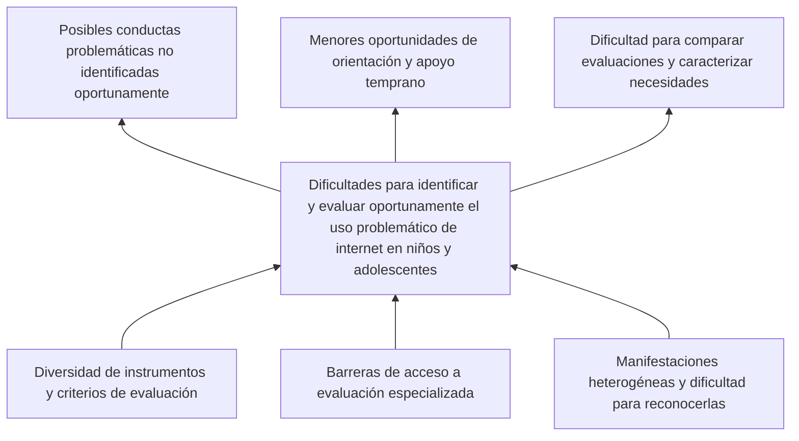

# Prediccion-Uso-Problematico-Internet MIAA 2026-2

**Primera entrega — Reporte de la primera etapa (20 %)**

| Información | Detalle |
|---|---|
| Institución | Universidad Icesi |
| Programa | Maestría en Inteligencia Artificial Aplicada (MIAA) |
| Asignatura | Proyecto de Innovación IA |
| Periodo | 2026-2 |
| Autor e integrante único | Christian Cuello |
| GitHub | [@ChrisCuello](https://github.com/ChrisCuello) |
| Estado | En desarrollo |
| Primera entrega | **10 de octubre de 2026** |
| Segunda entrega | **14 de noviembre de 2026** |
| Entrega final | **1 de diciembre de 2026** |

## 1. Introducción y contexto

Internet ofrece oportunidades de aprendizaje, comunicación y entretenimiento para niños y adolescentes. Su uso se considera **problemático** cuando aparecen dificultades de control y repercusiones negativas en el funcionamiento cotidiano; por tanto, no debe equipararse automáticamente con muchas horas de conexión. La investigación sobre el tema emplea diferentes conceptos e instrumentos, sin criterios de evaluación completamente uniformes [1–3].

El Child Mind Institute y Kaggle propusieron el reto *Child Mind Institute — Problematic Internet Use*, basado en información del **Healthy Brain Network (HBN)**, para investigar si mediciones físicas, demográficas y de actividad permiten predecir niveles de severidad de este fenómeno [4–5]. Se trata de una oportunidad para explorar aprendizaje automático en un problema de interés social, sin suponer que el modelo sustituye la valoración profesional.

## 2. Análisis del problema (10 %)

### 2.1. Definición del problema social

La identificación oportuna del uso problemático de internet en niños y adolescentes presenta dificultades por la heterogeneidad de sus manifestaciones, la diversidad de instrumentos de medición y las posibles barreras para acceder a evaluación especializada [1–3, 5].

La literatura describe **asociaciones** entre uso problemático y dificultades de sueño, bienestar psicológico, calidad de vida o funcionamiento cotidiano [2, 6–7]. Estas asociaciones no demuestran por sí mismas que el uso de internet sea su causa: pueden existir factores compartidos y relaciones bidireccionales. Esta distinción es esencial para formular un problema social defendible.

**Problema central:** Dificultades para identificar y evaluar oportunamente el uso problemático de internet en niños y adolescentes, debido a la complejidad del fenómeno y a las limitaciones de los métodos de detección disponibles.

### 2.2. Problema específico de investigación

Si bien los indicadores físicos, de actividad y demográficos pueden obtenerse mediante evaluaciones y dispositivos, **no está establecido para este proyecto** en qué medida predicen confiablemente la severidad del uso problemático de internet, especialmente cuando se excluye información directamente relacionada con la construcción de la etiqueta. La base HBN también presenta datos faltantes y variación en la disponibilidad de mediciones [4].

**Pregunta de investigación:** ¿En qué medida los modelos de aprendizaje automático permiten predecir los niveles de severidad del uso problemático de internet en niños y adolescentes a partir de variables físicas, demográficas y de actividad, utilizando los datos del Healthy Brain Network?

### 2.3. Justificación y alcance

La propuesta tiene valor **social**, porque estudia una dificultad de identificación y evaluación en población infantil y adolescente; **científico**, porque permitirá contrastar la capacidad predictiva y las limitaciones de diferentes variables; y **académico**, porque integra comprensión del problema, análisis de datos, modelado y evaluación crítica.

El resultado previsto es una **comparación exploratoria de modelos**, no una aplicación clínica, una herramienta diagnóstica ni una demostración de relaciones causales. La generalización a otras poblaciones requeriría evaluaciones adicionales.

### 2.4. Árbol de problemas: perspectiva social

Se diferencia entre causas o barreras que dificultan **identificar** el problema y factores asociados con el fenómeno. El diagrama representa un **marco conceptual por sustentar** y no relaciones causales verificadas experimentalmente.

**Interpretación.** La falta de criterios plenamente uniformes y la diversidad de instrumentos complican la comparación y detección estandarizada [1, 3]. Las barreras de acceso y la complejidad de las manifestaciones pueden limitar la identificación temprana [5]. Por separado, se estudiarán posibles relaciones con soledad, malestar emocional, sueño, actividad física y desempeño académico, **sin ubicarlas automáticamente como causas o consecuencias** [2, 6–7]. El aprendizaje automático constituye una respuesta tecnológica a explorar, no el problema social en sí.

### 2.5. Objetivos del proyecto

**Objetivo general.** Desarrollar y comparar, durante el periodo académico 2026-2, modelos de aprendizaje automático para predecir los cuatro niveles de severidad del uso problemático de internet en niños y adolescentes a partir de variables físicas, demográficas y de actividad del HBN, evaluando su desempeño y limitaciones.

**Objetivos específicos**

1. **Caracterizar** las fuentes y variables del conjunto de datos HBN, cuantificando datos faltantes, disponibilidad de etiquetas y distribución de los niveles de severidad.
2. **Diseñar** una estrategia reproducible de preparación de datos y entrenar modelos de referencia y modelos alternativos apropiados para una clasificación ordinal, evitando fuga de información.
3. **Comparar** el desempeño de los modelos mediante el **kappa ponderado cuadráticamente (QWK)** y métricas complementarias, examinando errores por categoría y posibles limitaciones de generalización.
4. **Documentar** los resultados, decisiones metodológicas y restricciones de uso en un informe académico y en GitHub.

## 3. Estado del arte: revisión y soluciones existentes (5 %)

### 3.1. Definición y evaluación del uso problemático de internet

La literatura no emplea una definición operacional única del uso problemático de internet. Una revisión sistemática de Schlossarek et al. (2024) compara instrumentos de cribado y sus propiedades psicométricas, evidenciando la necesidad de seleccionar e interpretar cuidadosamente las escalas [1]. Pérez-Wiesner et al. (2024) abordan la validación de instrumentos en adolescentes [3].

Esto es relevante porque el modelo predictivo tendrá como objetivo una **categoría construida a partir de un instrumento**, no un diagnóstico clínico universalmente establecido.

### 3.2. Factores asociados y repercusiones

Restrepo et al. (2020) estudiaron asociaciones entre uso problemático de internet, trastornos psiquiátricos y deterioro funcional en niños y adolescentes [2]. Tóth-Király et al. (2021) examinaron longitudinalmente trayectorias y antecedentes individuales y sociales, así como resultados asociados [6]. Machimbarrena et al. (2019) estudiaron perfiles de uso problemático y calidad de vida relacionada con la salud [7].

Estos trabajos sustentan la relevancia social del proyecto, aunque sus resultados no deben generalizarse automáticamente a toda la población ni interpretarse como causalidad confirmada.

### 3.3. Soluciones predictivas existentes

| Fuente | Solución o aporte informado | Utilidad y precaución para el proyecto |
|---|---|---|
| Competición Child Mind Institute y Kaggle [4] | Predicción de severidad mediante datos físicos, cuestionarios y actigrafía del HBN; evaluación con **QWK**. | Define el problema de referencia, la etiqueta ordinal y las condiciones de evaluación. |
| MREM-IUP, M. et al. (2024) [8] | Ensamble de regresores para evaluar el uso problemático a partir de indicadores físicos y conductuales. Consensus reporta **QWK 0,92**. | Comparación metodológica pertinente; resultado pendiente de validar en texto completo, particularmente variables utilizadas y separación de datos. |
| Suh y Yoo (2025) [9] | Predicción de nivel de riesgo desde una perspectiva de salud digital. | Referencia para explorar preprocesamiento y características; confirmar resultados y protocolo en el artículo. |
| Malallah e Iqbal (2026) [10] | Aprendizaje automático aplicado a indicios de uso problemático en niños. Consensus reporta exactitud del **100 %**. | Cifra que requiere revisión crítica: verificar si corresponde a entrenamiento, validación independiente y posible fuga de información. |
| R. y S. (2025) [11] | Ensamble y optimización bayesiana sobre datos estructurados; Consensus reporta **QWK 0,72**. | Referencia técnica preliminar; verificar métrica y diseño de validación en la publicación. |

**Análisis comparativo preliminar.** Los trabajos anteriores sugieren que los ensambles y el tratamiento de datos heterogéneos son alternativas relevantes. No obstante, las cifras provenientes del reporte automatizado de Consensus **no constituyen resultados verificados directamente en esta etapa**. Accuracy, AUC y QWK no son métricas intercambiables; tampoco puede inferirse superioridad sin evaluar los mismos datos, predictores y protocolos de validación.

### 3.4. Brechas y aporte esperado

- Determinar cuánto pueden predecir las variables físicas, demográficas y de actividad **sin** incluir información que revele la etiqueta.
- Evaluar el efecto de datos faltantes y el desbalance entre las cuatro categorías.
- Comparar modelos bajo un procedimiento común de evaluación, con atención al orden de las categorías.
- Reconocer sesgos de muestreo, límites de interpretación y ausencia de validación clínica externa.

**Precaución fundamental sobre fuga de información:** `sii` se deriva de `PCIAT-PCIAT_Total` [4]. Ese total, así como variables que permitan reconstruirlo directa o indebidamente, no deben usarse como predictores de una evaluación independiente.

## 4. Planeación: tareas y cronograma (5 %)

El proyecto se organizará con una adaptación de **CRISP-DM**: comprensión del problema, comprensión de datos, preparación, modelado, evaluación y comunicación. El trabajo será realizado por **un solo estudiante**. Se utilizarán Google Colab y Python para el procesamiento, y GitHub para documentación y control de versiones. Los archivos de datos masivos permanecerán fuera del repositorio.

### 4.1. Cronograma y productos verificables

| Periodo | Actividades | Producto o hito | Entrega |
|---|---|---|---|
| **9–10 oct. 2026** | Delimitar problema social y pregunta, objetivos, árbol conceptual, revisión inicial de bibliografía, plan y cronograma. | README actualizado y reporte de primera etapa. | **1: 10 de octubre (20 %)** |
| **11–24 oct. 2026** | Acceder al HBN desde Kaggle/Colab; revisar diccionario, variables, etiquetas y valores ausentes. | Inventario de variables y primeras tablas exploratorias. | Preparación de entrega 2 |
| **25 oct.–7 nov. 2026** | Analizar distribuciones, desbalance, posibles fugas y variables candidatas; proponer transformaciones. | Análisis exploratorio y justificación de variables. | Preparación de entrega 2 |
| **8–14 nov. 2026** | Establecer particiones y modelos base; formular hipótesis y realizar experimentos iniciales. | Reporte de exploración, modelos de referencia y pruebas. | **2: 14 de noviembre (10 %)** |
| **15–23 nov. 2026** | Refinar preprocesamiento, entrenar y ajustar alternativas, comparar QWK y otras métricas. | Resultados comparativos y evaluación de errores. | Preparación de entrega 3 |
| **24 nov.–1 dic. 2026** | Discusión crítica, limitaciones, conclusiones, bibliografía y video de 10 minutos. | Informe final, repositorio documentado y video. | **3: 1 de diciembre (70 %)** |

**Riesgos y mitigación previstos:** (a) archivos de actigrafía voluminosos: procesar selectivamente en Colab; (b) datos faltantes: evaluar estrategias dentro de las particiones de entrenamiento; (c) desbalance: emplear métricas adecuadas y revisar desempeño por clase; (d) fuga de información: excluir campos derivados del instrumento que determina la etiqueta; (e) capacidad computacional y tiempo individual: iniciar con modelos sencillos y datos tabulares, ampliando solo si es viable.

### 4.2. Relación con la rúbrica general

| Etapa | Criterios de evaluación |
|---|---|
| **Primera (20 %)** | Análisis del problema, objetivos y árbol (10 %); estado del arte y soluciones existentes (5 %); tareas y cronograma (5 %). |
| **Segunda (10 %)** | Análisis exploratorio y justificación de datos/variables (5 %); hipótesis, modelos de referencia y experimentos iniciales (5 %). |
| **Tercera (70 %)** | Reporte final con introducción, metodología, resultados, discusión, conclusiones y referencias; video de sustentación de 10 minutos, según la rúbrica integral del curso. |

## 5. Datos y herramientas previstas

**Origen:** [Child Mind Institute — Problematic Internet Use (Kaggle)](https://www.kaggle.com/competitions/child-mind-institute-problematic-internet-use).

**Datos:** archivos tabulares CSV y series de actigrafía Parquet del Healthy Brain Network [4]. El análisis detallado de su calidad y de la viabilidad de las variables corresponde a la segunda entrega.

**Variable objetivo:** `sii` (*Severity Impairment Index*): **0, ninguno; 1, leve; 2, moderado; 3, severo**. La evaluación de referencia emplea QWK [4].

**Herramientas:** Google Colab, Python, Pandas, Scikit-learn, Kaggle y [KaggleHub](https://github.com/Kaggle/kagglehub); [GitHub](https://github.com/ChrisCuello/Prediccion-Uso-Problematico-Internet-MIAA-2026-2) para el seguimiento de versiones.

## 6. Consideraciones éticas y limitaciones

El estudio utiliza información compartida sin identificación directa de los participantes, sujeta a las condiciones de uso de la fuente. Por tratarse de menores de edad y variables potencialmente sensibles, los análisis deberán evitar inferencias clínicas injustificadas, no publicar información identificable y reconocer sesgos o limitaciones de representatividad.

Un buen resultado predictivo en este dataset **no equivale** a detección clínica temprana validada ni demuestra relaciones causales. Cualquier aplicación real necesitaría validación adicional en poblaciones y contextos de uso independientes.

## 7. Referencias bibliográficas

Las referencias [1–7] fundamentan el contexto y el reto. Las referencias [8–11] se incorporan como **antecedentes predictivos preliminares** identificados mediante Consensus; los valores de desempeño deberán corroborarse contra sus artículos originales antes de considerarse definitivos.

1. Schlossarek, S., et al. (2024). *Which Are the Optimal Screening Tools for Internet Use Disorder in Children and Adolescents? A Systematic Review of Psychometric Evidence*. Current Addiction Reports. https://doi.org/10.1007/s40429-024-00568-w
2. Restrepo, A., et al. (2020). *Problematic internet use in children and adolescents: associations with psychiatric disorders and impairment*. BMC Psychiatry. https://doi.org/10.1186/s12888-020-02640-x
3. Pérez-Wiesner, M., Bühler, K., & López-Moreno, J. A. (2024). *Validation of an Instrument for Detecting Problematic Internet Use in Adolescents*. Behavioral Sciences. https://doi.org/10.3390/bs14080715
4. Kaggle / Child Mind Institute. *Child Mind Institute — Problematic Internet Use: Overview, Data and Evaluation*. https://www.kaggle.com/competitions/child-mind-institute-problematic-internet-use
5. Child Mind Institute. (2024). *Child Mind Institute and Kaggle Launch Competition to Predict Teen Internet Addiction*. https://childmind.org/blog/child-mind-institute-and-kaggle-launch-competition-to-predict-teen-internet-addiction/
6. Tóth-Király, I., et al. (2021). *Longitudinal Trajectories, Social and Individual Antecedents, and Outcomes of Problematic Internet Use Among Late Adolescents*. Child Development. https://doi.org/10.1111/cdev.13525
7. Machimbarrena, J. M., et al. (2019). *Profiles of Problematic Internet Use and Its Impact on Adolescents’ Health-Related Quality of Life*. International Journal of Environmental Research and Public Health. https://doi.org/10.3390/ijerph16203877
8. M., K., et al. (2024). *MREM-IUP - A MultiRegressor Based Ensemble Model for Assessing the Internet Addiction in Youth Using Physical and Behavioural Indicators*. https://doi.org/10.70135/seejph.vi.2370
9. Suh, Y., & Yoo, J. (2025). *Risk level prediction for problematic internet use: A digital health perspective*. Internet Interventions. https://doi.org/10.1016/j.invent.2025.100863
10. Malallah, F., & Iqbal, K. (2026). *Predicting Signs of Problematic Internet Use to Analyze Children's Health Using Machine Learning*. https://doi.org/10.5220/0014231300004070
11. R., N. K., & S, P. (2025). *Predicting Problematic Internet Use in Children Using Feature-Rich Structured Data with Ensemble Machine Learning and Bayesian Optimisation*. https://doi.org/10.1109/apsipaasc65261.2025.11249107

**Documentación académica utilizada:** Universidad Icesi, *Proyecto de curso: elige tu reto*, *Plantilla de reporte escrito* y *Porcentajes de evaluación* (2026). Los dos reportes de Consensus suministrados sirvieron para localizar literatura; no se emplearon como sustitutos de publicaciones científicas originales.
