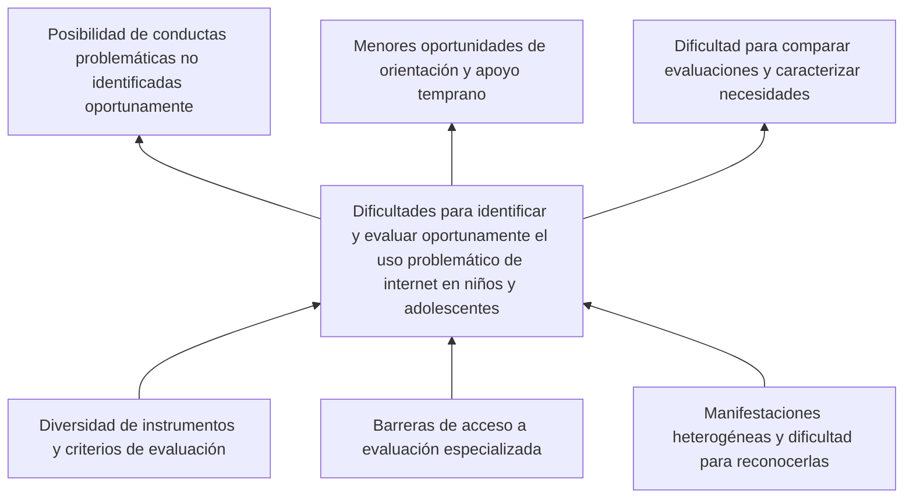

# Prediccion-Uso-Problematico-Internet MIAA 2026-2

**Universidad Icesi — Maestría en Inteligencia Artificial Aplicada**  
**Asignatura:** Proyecto de Innovación IA · **Periodo académico:** 2026-2  
**Autor:** Christian Cuello · [GitHub: ChrisCuello](https://github.com/ChrisCuello)  
**Estado:** Proyecto en desarrollo

## Presentación

Internet forma parte de la vida cotidiana de niños y adolescentes y ofrece oportunidades de aprendizaje, comunicación y entretenimiento. Sin embargo, su utilización puede considerarse problemática cuando existen dificultades para regularla y se presentan interferencias en las actividades habituales, las relaciones personales o el bienestar. Esta condición no se define únicamente por la cantidad de horas de conexión: involucra comportamientos, contextos y repercusiones que no siempre son fáciles de evaluar [1–3].

El interés por comprender este fenómeno ha motivado estudios sobre sus manifestaciones y factores asociados, así como la búsqueda de métodos que complementen las evaluaciones tradicionales. Entre estas iniciativas se encuentra la competición *Child Mind Institute — Problematic Internet Use*, organizada con Kaggle a partir de datos del estudio **Healthy Brain Network (HBN)**. El reto invita a investigar si indicadores físicos y de actividad, junto con otras características de los participantes, permiten estimar niveles de severidad del uso problemático de internet [4, 5].

En este contexto, el proyecto **Prediccion-Uso-Problematico-Internet MIAA 2026-2** plantea una investigación académica basada en aprendizaje automático. Su propósito no es establecer diagnósticos ni reemplazar la valoración profesional, sino examinar el potencial y las limitaciones de una aproximación predictiva construida con datos existentes.

## Contexto y delimitación del problema

La evaluación del uso problemático de internet en población infantil y adolescente enfrenta dificultades conceptuales y prácticas. Los estudios utilizan instrumentos y criterios que no son completamente uniformes, mientras que las manifestaciones del fenómeno pueden variar según la edad, las circunstancias personales y las actividades realizadas en línea [1, 3]. A esto pueden sumarse barreras para acceder a valoraciones especializadas y la dificultad de reconocer oportunamente cuándo determinados comportamientos requieren atención [5].

La relevancia de esta situación se relaciona con los hallazgos de investigaciones que describen asociaciones entre el uso problemático de internet y el funcionamiento cotidiano, la calidad de vida y algunos aspectos de la salud mental [2, 6, 7]. No obstante, estas asociaciones deben interpretarse con prudencia: no permiten afirmar por sí solas que un mayor uso de internet cause ansiedad, alteraciones del sueño o dificultades académicas. Las relaciones pueden ser bidireccionales o depender de otros factores.

De este análisis se desprende el problema social que motiva la investigación: **las dificultades para identificar y evaluar oportunamente el uso problemático de internet en niños y adolescentes, en un escenario de manifestaciones heterogéneas, diversidad de instrumentos y posibles barreras de acceso a evaluación especializada**.

### Relaciones entre causas y efectos

El árbol de problemas sintetiza las barreras que podrían contribuir a esta dificultad y algunas de sus consecuencias potenciales. Su organización parte del problema social, sin confundirlo con las tareas técnicas necesarias para construir un modelo predictivo.

*Figura 1. Árbol de problemas propuesto a partir de la revisión inicial de literatura. Las conexiones expresan relaciones conceptuales plausibles que requieren sustento documental; no representan efectos causales demostrados experimentalmente.*

Las dificultades en la definición y medición pueden obstaculizar una evaluación consistente [1, 3]. Asimismo, las barreras de acceso y la variedad de manifestaciones podrían restringir las oportunidades de identificación y orientación temprana [5]. Por otra parte, factores como la soledad, el malestar psicológico, el sueño y la actividad física se estudiarán como posibles **variables asociadas**, sin clasificarlas de antemano como causas o consecuencias directas [2, 6, 7].

### Pregunta y propósito de la investigación

El desafío planteado por el Child Mind Institute ofrece la posibilidad de explorar una respuesta tecnológica parcial a este problema social. Aunque las mediciones físicas, demográficas y de actividad están disponibles en el HBN, aún es necesario establecer cuánto aportan a una predicción confiable cuando se excluyen variables que revelan directamente la etiqueta de severidad. El conjunto de datos, además, presenta valores faltantes y diferencias en la disponibilidad de mediciones entre participantes [4].

La investigación se orienta mediante la siguiente pregunta:

> **¿En qué medida los modelos de aprendizaje automático permiten predecir los niveles de severidad del uso problemático de internet en niños y adolescentes a partir de variables físicas, demográficas y de actividad, utilizando los datos del Healthy Brain Network?**

Para responderla, se propone **desarrollar y comparar, a más tardar el 1 de diciembre de 2026, al menos tres configuraciones de aprendizaje automático para predecir los cuatro niveles de severidad del uso problemático de internet**, utilizando los datos del HBN y evaluando su desempeño mediante QWK, F1-macro y matrices de confusión, así como sus limitaciones metodológicas.

Este propósito se desarrollará mediante tres objetivos específicos:

1. **Caracterizar, hasta el 14 de noviembre de 2026, la totalidad de las variables del conjunto tabular de entrenamiento del HBN**, documentando el porcentaje de valores faltantes por variable, la disponibilidad de la etiqueta `sii`, la distribución de las cuatro categorías y los criterios preliminares de selección y exclusión de predictores.
2. **Preparar los datos e implementar, hasta el 14 de noviembre de 2026, al menos dos modelos de referencia**, documentando la partición de entrenamiento y validación, las decisiones de preprocesamiento y el control de fuga de información, incluida la exclusión de `PCIAT-PCIAT_Total` como predictor de `sii`.
3. **Comparar, hasta el 1 de diciembre de 2026, al menos tres configuraciones predictivas**, utilizando QWK como métrica principal, F1-macro y matrices de confusión como medidas complementarias, y presentar un análisis de errores por categoría y de las limitaciones para generalizar los resultados.

La investigación tiene interés social por el fenómeno abordado y valor metodológico por la oportunidad de estudiar datos heterogéneos, sesgos de representación y técnicas de predicción en un contexto sensible. Sus productos tendrán carácter exploratorio y académico.

## Antecedentes científicos y tecnológicos

### Comprensión y medición del uso problemático de internet

La ausencia de una definición operacional plenamente uniforme constituye una dificultad relevante para estudiar el fenómeno. Schlossarek et al. (2024) revisaron instrumentos de cribado destinados a niños y adolescentes y analizaron sus propiedades psicométricas [1]. Por su parte, Pérez-Wiesner et al. (2024) abordaron la validación de un instrumento para identificar uso problemático de internet en adolescentes [3]. Estos antecedentes muestran por qué la elección de una escala, sus criterios y su población de aplicación deben examinarse antes de interpretar sus resultados.

La información anterior es particularmente importante para el presente proyecto: el desenlace que se intentará predecir es una categoría derivada de una medición específica, no un diagnóstico clínico universal.

### Asociaciones con bienestar y funcionamiento cotidiano

Restrepo et al. (2020) investigaron asociaciones entre uso problemático de internet, trastornos psiquiátricos y deterioro funcional en niños y adolescentes [2]. Tóth-Király et al. (2021) estudiaron trayectorias longitudinales y antecedentes individuales y sociales, así como resultados asociados [6]. Machimbarrena et al. (2019) analizaron perfiles de uso problemático y calidad de vida relacionada con la salud [7].

En conjunto, estos trabajos proporcionan fundamento para la relevancia social de la investigación y, a la vez, invitan a distinguir entre asociación estadística, capacidad de predicción y causalidad. Una variable que ayude a estimar un nivel de severidad no necesariamente explica su origen ni constituye por sí misma un criterio para intervenir.

### Desarrollo de soluciones predictivas

El reto del Child Mind Institute y Kaggle plantea una tarea de predicción sobre cuatro categorías ordenadas de severidad, utilizando datos del HBN. Entre los recursos disponibles se encuentran variables demográficas y físicas, cuestionarios y series de actigrafía. La competición propone evaluar la concordancia entre valores reales y predichos mediante el **coeficiente kappa ponderado cuadráticamente (QWK)** [4].

La revisión bibliográfica preliminar también permitió identificar trabajos que estudian enfoques de aprendizaje automático para este problema o problemas estrechamente relacionados:

| Investigación | Enfoque descrito | Consideración para este proyecto |
|---|---|---|
| Karthiga M. et al. (2024) [8] | Ensamble de LightGBM, XGBoost, CatBoost y TabNet; el resumen del artículo original reporta **QWK = 0,92**. | El resultado está documentado por la revista; se requiere examinar las variables utilizadas y el protocolo de validación antes de compararlo con los experimentos propios. |
| Suh y Yoo (2025) [9] | Predicción del nivel de riesgo desde una perspectiva de salud digital. | Revisar los métodos de preparación de datos y los factores considerados. |
| Malallah e Iqbal (2026) [10] | Estudio con datos del HBN; el resumen editorial original reporta **exactitud del 100 %** para Gradient Boost Regression. | Comprobar el alcance de la métrica y el procedimiento de validación descrito; examinar posibles riesgos de sobreajuste y fuga de información antes de interpretarla como generalizable. |
| Niteesh K. R. y Pooja T. S. (2025) [11] | Comparación de ensambles con optimización bayesiana; el artículo original reporta para XGBoost **QWK medio = 0,7218** en validación cruzada estratificada de cinco particiones. | La métrica procede de la tabla de resultados publicada; su comparación requiere considerar la partición y los predictores empleados. |

Estos antecedentes sugieren alternativas de modelado que vale la pena explorar. Los valores de QWK de [8] y [11], y la exactitud declarada por [10], fueron contrastados con las publicaciones originales; **esta comprobación bibliográfica no equivale a validar de manera independiente sus experimentos**. En particular, los valores extremos deben analizarse a la luz de las variables, las particiones y la posibilidad de fuga de información. Tampoco resulta válido comparar directamente exactitud, AUC y QWK, porque miden aspectos distintos y pueden provenir de diseños experimentales diferentes. Para [9] queda pendiente examinar en detalle el texto completo.

El aporte esperado del proyecto consistirá en evaluar modelos bajo condiciones de preparación y validación comparables, examinando de manera explícita los valores faltantes, la distribución de las categorías, las variables utilizadas y la posibilidad de generalizar los resultados.

Una precaución central es evitar la **fuga de información**. En los datos de la competición, la categoría `sii` se deriva de `PCIAT-PCIAT_Total` [4]. Incluir ese total —o información que permita reconstruir directamente la etiqueta— como predictor produciría una evaluación engañosa de la capacidad del modelo para aprender a partir de indicadores físicos y de actividad.

## Enfoque metodológico y desarrollo previsto

El trabajo seguirá una adaptación de **CRISP-DM**, iniciando con la comprensión del problema y de los datos, para continuar con su preparación, el desarrollo de modelos, la evaluación y la comunicación de resultados. Esta secuencia permite vincular las decisiones técnicas con la pregunta de investigación y documentar el proceso de manera reproducible.

Se utilizarán los datos publicados para la competición *Child Mind Institute — Problematic Internet Use*, procedentes del Healthy Brain Network [4]. La información incluye archivos tabulares en formato CSV y series de actigrafía en formato Parquet. La variable objetivo, `sii` (*Severity Impairment Index*), presenta cuatro niveles ordenados: **0 (ninguno), 1 (leve), 2 (moderado) y 3 (severo)**. La exploración detallada de la base, la selección de variables y los experimentos se efectuarán durante las siguientes fases del proyecto.

La implementación se realizará principalmente con **Python en Google Colab**, apoyándose en Pandas y Scikit-learn. Kaggle y, cuando resulte apropiado, KaggleHub facilitarán el acceso a los recursos. GitHub se utilizará para documentar avances, scripts, notebooks y decisiones; las bases de datos voluminosas no se incorporarán directamente al repositorio.

### Plan de trabajo

El calendario corresponde al desarrollo individual del proyecto durante el último trimestre de 2026. Las fechas indican hitos académicos y periodos de trabajo previstos; no representan resultados ya obtenidos.

| Periodo | Trabajo previsto | Producto esperado |
|---|---|---|
| **Hasta el 10 de octubre** | Delimitación del problema, revisión bibliográfica inicial, árbol de problemas, formulación de objetivos y organización del proyecto. | Documento inicial publicado en GitHub. |
| **11–24 de octubre** | Acceso a los recursos de HBN, comprensión del diccionario de datos, identificación de variables y evaluación inicial de su disponibilidad. | Inventario de variables y primeras observaciones exploratorias. |
| **25 de octubre–7 de noviembre** | Análisis de valores faltantes, desbalance, relaciones entre variables y posibles fuentes de fuga de información. | Análisis exploratorio documentado y justificación inicial de variables. |
| **8–14 de noviembre** | Preparación de particiones de datos, definición de hipótesis y entrenamiento de **al menos dos modelos de referencia**, con control documentado de fuga de información. | Reporte de exploración y primeros experimentos, con entrega el **14 de noviembre**. |
| **15–23 de noviembre** | Comparación y ajuste de modelos hasta completar **al menos tres configuraciones**, evaluación con QWK y F1-macro y análisis de matrices de confusión. | Resultados comparativos y discusión preliminar. |
| **24 de noviembre–1 de diciembre** | Integración de resultados, discusión de limitaciones, conclusiones, revisión de referencias y preparación del video académico. | Informe final y sustentación en video, con entrega el **1 de diciembre**. |

El volumen de los archivos de actigrafía y los recursos computacionales disponibles en Colab hacen aconsejable iniciar con un modelo de referencia basado en información tabular. La incorporación de las series temporales dependerá de su viabilidad, del tiempo disponible y del valor analítico que puedan aportar. La preparación y cualquier técnica de balanceo deberán realizarse sin utilizar información del conjunto de evaluación para ajustar el modelo.

## Alcance, consideraciones éticas y limitaciones

El proyecto empleará datos disponibles para investigación que se distribuyen sin identificación directa de los participantes, respetando las condiciones de uso de la fuente. Al trabajar con información vinculada con menores de edad y salud mental, se evitará publicar datos identificables, se reconocerán los posibles sesgos del conjunto y se presentarán las predicciones con prudencia.

El desempeño de un modelo en esta base no demuestra que pueda detectar casos clínicos en escenarios reales. Tampoco permite concluir que las características físicas o de actividad sean causas del uso problemático de internet. Una aplicación externa exigiría validación independiente, evaluación de seguridad y consideración del contexto de uso y de las poblaciones a las que estaría dirigida.

## Referencias

1. Schlossarek, S., et al. (2024). *Which Are the Optimal Screening Tools for Internet Use Disorder in Children and Adolescents? A Systematic Review of Psychometric Evidence*. Current Addiction Reports. https://doi.org/10.1007/s40429-024-00568-w
2. Restrepo, A., et al. (2020). *Problematic internet use in children and adolescents: associations with psychiatric disorders and impairment*. BMC Psychiatry. https://doi.org/10.1186/s12888-020-02640-x
3. Pérez-Wiesner, M., Bühler, K., & López-Moreno, J. A. (2024). *Validation of an Instrument for Detecting Problematic Internet Use in Adolescents*. Behavioral Sciences. https://doi.org/10.3390/bs14080715
4. Kaggle / Child Mind Institute. *Child Mind Institute — Problematic Internet Use: Overview, Data and Evaluation*. https://www.kaggle.com/competitions/child-mind-institute-problematic-internet-use
5. Child Mind Institute. (2024). *Child Mind Institute and Kaggle Launch Competition to Predict Teen Internet Addiction*. https://childmind.org/blog/child-mind-institute-and-kaggle-launch-competition-to-predict-teen-internet-addiction/
6. Tóth-Király, I., et al. (2021). *Longitudinal Trajectories, Social and Individual Antecedents, and Outcomes of Problematic Internet Use Among Late Adolescents*. Child Development. https://doi.org/10.1111/cdev.13525
7. Machimbarrena, J. M., et al. (2019). *Profiles of Problematic Internet Use and Its Impact on Adolescents’ Health-Related Quality of Life*. International Journal of Environmental Research and Public Health. https://doi.org/10.3390/ijerph16203877
8. Karthiga M., Sureshraja Ramar, Archudha A., Kavya D. N., Deepshree Buchade y Asesh Kumar Tripathy. (2024). *MREM-IUP - A MultiRegressor Based Ensemble Model for Assessing the Internet Addiction in Youth Using Physical and Behavioural Indicators*. *South Eastern European Journal of Public Health*, vol. XXV, pp. 1182–1189. https://doi.org/10.70135/seejph.vi.2370
9. Suh, Y., & Yoo, J. (2025). *Risk level prediction for problematic internet use: A digital health perspective*. Internet Interventions. https://doi.org/10.1016/j.invent.2025.100863
10. Malallah, F. L., e Iqbal, K. (2026). *Predicting Signs of Problematic Internet Use to Analyze Children's Health Using Machine Learning*. En *Proceedings of the 19th International Joint Conference on Biomedical Engineering Systems and Technologies*, vol. 1, BIOSIGNALS (pp. 247–254). SciTePress. https://doi.org/10.5220/0014231300004070
11. Niteesh K. R. y Pooja T. S. (2025). *Predicting Problematic Internet Use in Children Using Feature-Rich Structured Data with Ensemble Machine Learning and Bayesian Optimisation*. En *2025 Asia Pacific Signal and Information Processing Association Annual Summit and Conference (APSIPA ASC)* (pp. 1627–1632). https://doi.org/10.1109/APSIPAASC65261.2025.11249107
